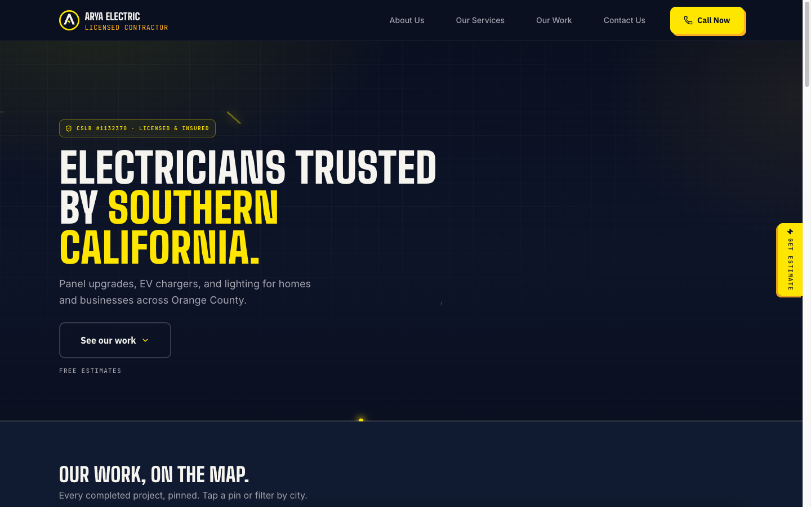
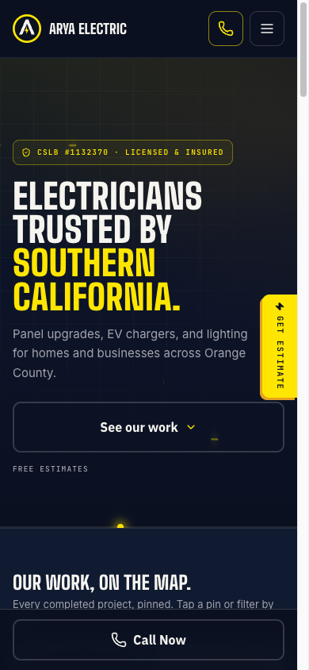
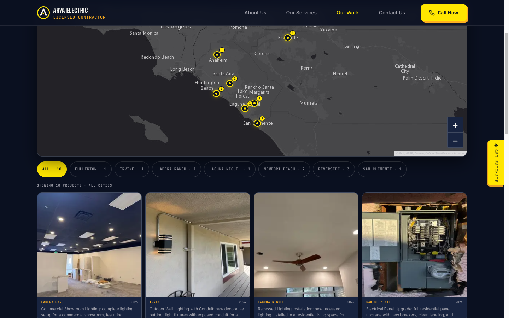
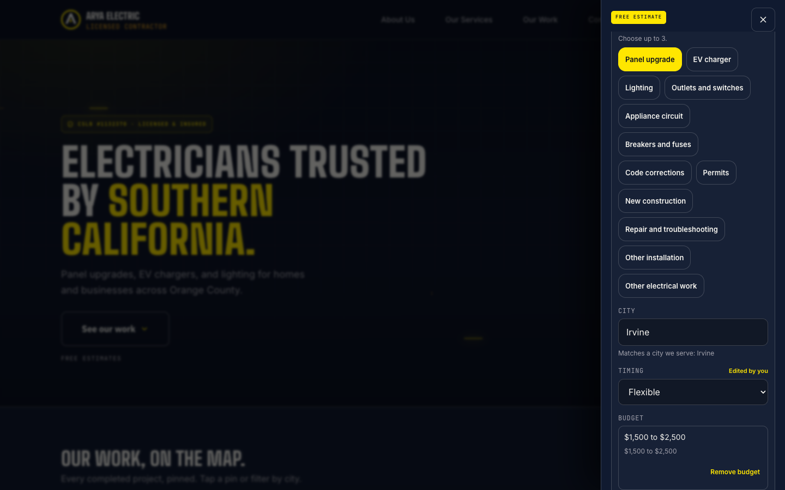
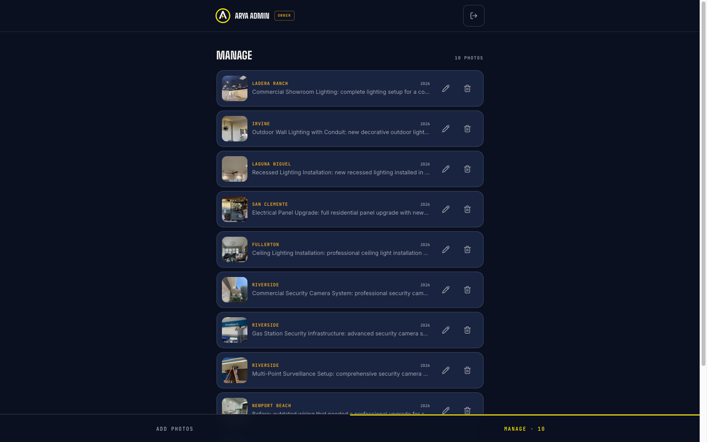
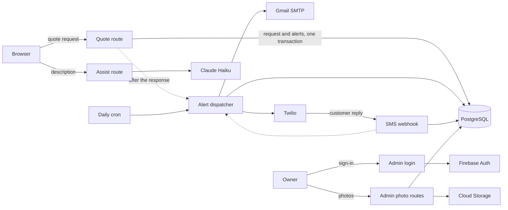

# Arya Electric

A TypeScript build of [aryaelectric.com](https://aryaelectric.com), page for
page, with its own PostgreSQL and Firebase backend. The site is for a licensed
electrical contractor in Orange County, California: customers browse finished
jobs on a map and request quotes, each request emails the owner and confirms to
the customer by text, email or both, and the owner manages job photos from a
signed-in dashboard. The source is private; this repo holds screenshots and
technical notes.

| Home | Phone |
| --- | --- |
|  |  |

| Job map and gallery | Quote review with extracted fields |
| --- | --- |
|  |  |

## Stack

- Next.js 15 (App Router), React 19, TypeScript (strict), Tailwind CSS 4
- PostgreSQL through node-postgres; PGlite (PostgreSQL in WebAssembly) for
  local runs and tests
- Firebase Authentication and Cloud Storage, Admin SDK on the server
- Claude Haiku through the Anthropic SDK, Zod
- Twilio for SMS, Nodemailer over Gmail SMTP for email
- Leaflet, Vitest, GitHub Actions, Vercel (hosting and cron)

## Architecture

## Quote requests and alerts

- A request and its alerts are written in one transaction (transactional
  outbox), and the response returns before anything is sent.
- A dispatcher claims due alerts with `FOR UPDATE SKIP LOCKED`. It runs through
  `after()` once each request or incoming text has been answered, and from a
  daily cron.
- Failed sends retry after 30 s, 2 min, 10 min, 30 min and 1 h, and are marked
  failed after the sixth attempt.
- Each form submission ID and each Twilio message ID is stored once, so a
  double submit or a redelivered webhook is handled once.
- Incoming texts must pass Twilio's signature check. They are matched to the
  customer's latest request on the last ten digits of the number, forwarded to
  the owner by email, and answered with an auto-reply, or an unsubscribe
  confirmation for STOP and similar words.
- If the database is down, the route emails the owner and confirms to the
  customer directly, within the function's time limit.

## Quote intake with Claude Haiku

- An optional step turns the customer's description into property type,
  services, city, timing, budget and details, plus a short summary for the
  owner. Only the description is sent, never the name, phone or email, and the
  customer reviews every field before sending.
- The model returns structured output defined by a Zod schema, which is parsed
  again on return. Output that fails is dropped and the form works without it.
- City, timing, budget and each detail must quote the description, or they are
  dropped. Budgets must be whole dollars under a ceiling, and the city must be
  one the business serves.
- The summary comes back with an HMAC-SHA256 token bound to the description,
  so the quote route only accepts a summary generated for that text.
- Per-IP limits (the IP is stored as a keyed hash), site-wide hourly, daily and
  monthly caps in PostgreSQL, and a one-hour pause if the provider's spend
  limit is hit.
- The quote form also runs in Spanish and Persian (right to left).

## Admin dashboard

- Firebase email sign-in. The server verifies the ID token, including
  revocation and a recent sign-in, checks that the account is an owner (admin
  claim, or a verified email on an allow list), and sets a 7-day httpOnly
  session cookie. The browser SDK uses in-memory persistence and signs out once
  the cookie is set.
- Every admin page and route verifies the cookie again, and sign-out revokes
  the refresh tokens on every device.
- Photos are resized in the browser to JPEG, at most 2,000 px on the long side
  at quality 0.85, before upload.
- Only the server writes to Cloud Storage (the bucket rules deny all client
  access). Each photo is a PostgreSQL row with its city and description, and a
  delete removes the row before the file.
- Each change clears the cached gallery with `revalidateTag`, so public pages
  update without a redeploy.

## Data and tests

- Tables: `leads`, `lead_messages`, `events` (the alert queue),
  `gallery_photos`, and `kv_strings` and `kv_hashes` for rate-limit counters.
- Numbered migrations, each in its own transaction under a PostgreSQL advisory
  lock.
- 33 Vitest files. Database tests run real SQL on in-memory PGlite; Firebase
  Admin, email and SMS are faked.
- CI on every push and pull request: lint, a logging check, tests, build, type
  check and a smoke test.

The business name, logo, photos and site wording belong to Arya Electric.
